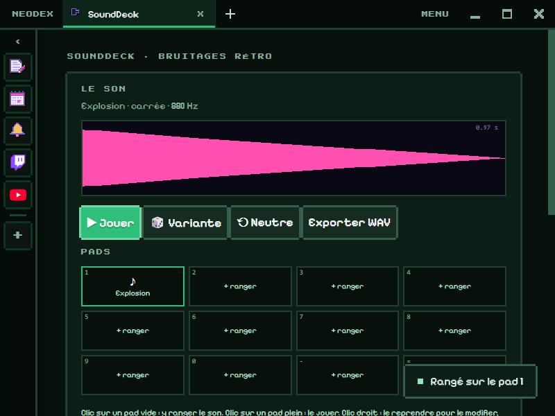

# SoundDeck

Make retro sound effects for your games, in a few clicks.

*Version française : [README.md](README.md)*

## Roll a random sound

8 families: **coin**, **jump**, **laser**, **explosion**, **power-up**, **hit**, **click** and **door**. Each click rolls a new sound of the family and plays it. **🎲 Variation** changes the current sound's settings a little, to find the right version.

## Tuning

- 5 waveforms: square, sawtooth, sine, triangle, noise.
- 14 sliders: pitch, slide (pitch going up or down), square width, attack, sustain, decay, punch, vibrato and its speed, arpeggio (a pitch jump at a given time), filter, crush (a more "8-bit" sound) and volume.
- The waveform is drawn live; a click on it (or **Space**) plays the sound.

## Pads

12 pads to store your sounds: click an empty pad to store the current sound, click a full pad to play it, right click to take it back or clear it. Keys **1** to **9**, **0**, **-** and **=** play the pads, like a drum machine.

## Export

**Export WAV**: the current sound, 44.1 kHz mono, ready for a game engine.

## Data

The current sound and the pads are kept in the plugin folder. Permission: `storage` only.
