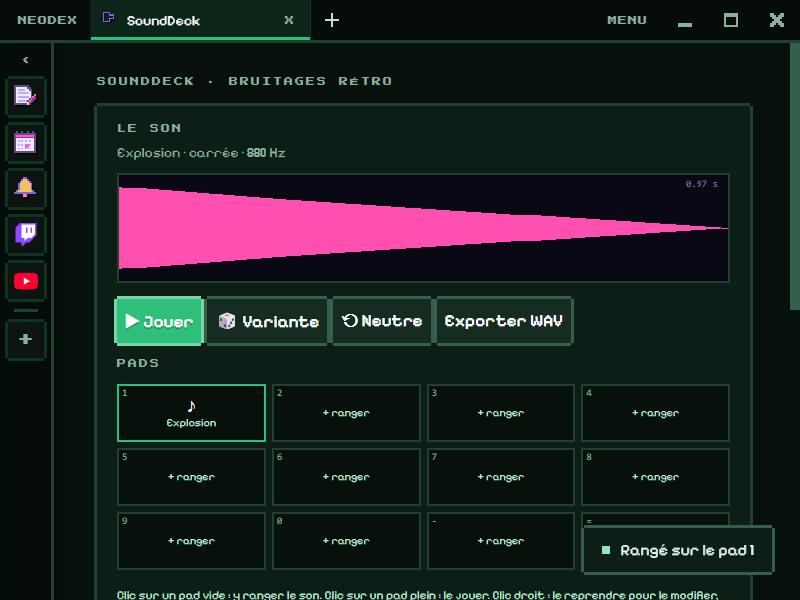

# SoundDeck

Fabrique des bruitages rétro pour tes jeux, en quelques clics.

*English version: [README.en.md](README.en.md)*

## Tirer un son au hasard

8 familles : **pièce**, **saut**, **laser**, **explosion**, **bonus**, **touché**, **clic** et **porte**. Chaque clic tire un nouveau son de la famille et le joue. **🎲 Variante** change un peu les réglages du son en cours, pour trouver la bonne version.

## Régler

- 5 formes d'onde : carrée, dent de scie, sinus, triangle, bruit.
- 14 curseurs : hauteur, glissando (la hauteur qui monte ou descend), largeur de la carrée, attaque, tenue, chute, punch, vibrato et sa vitesse, arpège (un saut de hauteur à un moment donné), filtre, écrasement (son plus « 8 bits ») et volume.
- La forme d'onde est dessinée en direct ; un clic dessus (ou **Espace**) joue le son.

## Les pads

12 pads pour ranger tes sons : clic sur un pad vide pour y ranger le son en cours, clic sur un pad plein pour le jouer, clic droit pour le reprendre ou le vider. Les touches **1** à **9**, **0**, **-** et **=** jouent les pads, comme une boîte à rythmes.

## Exporter

**Exporter WAV** : le son en cours, en 44,1 kHz mono, prêt pour un moteur de jeu.

## Données

Le son en cours et les pads sont gardés dans le dossier du plugin. Autorisation : `storage` seulement.
